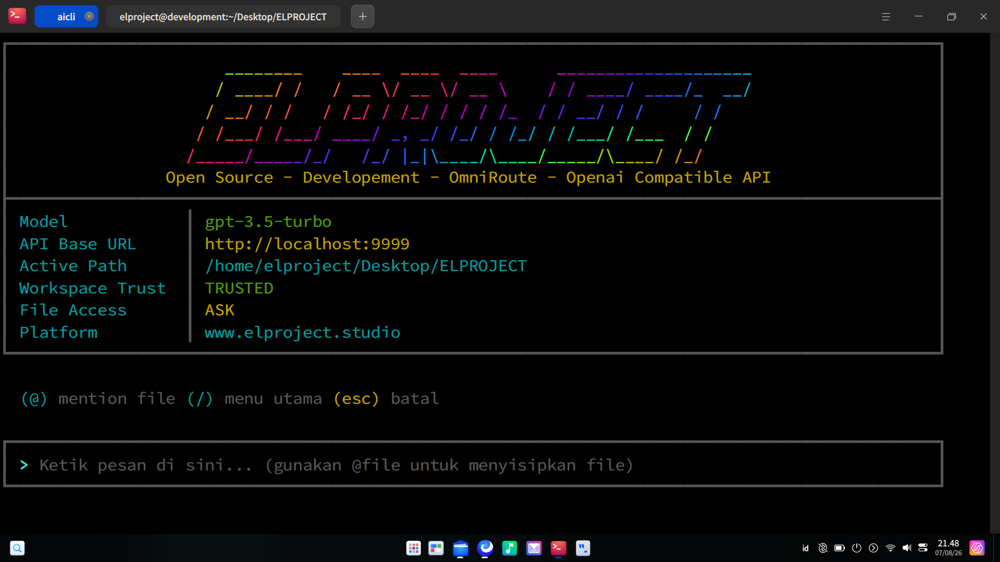
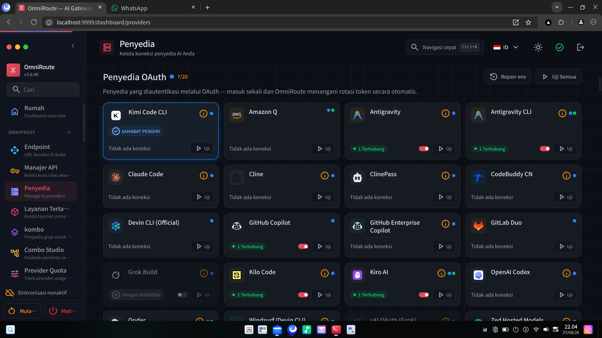
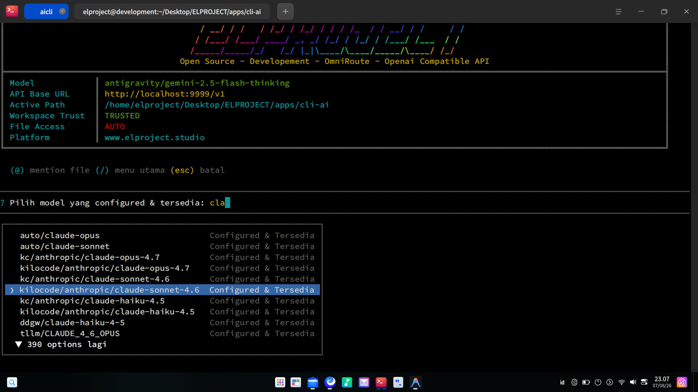
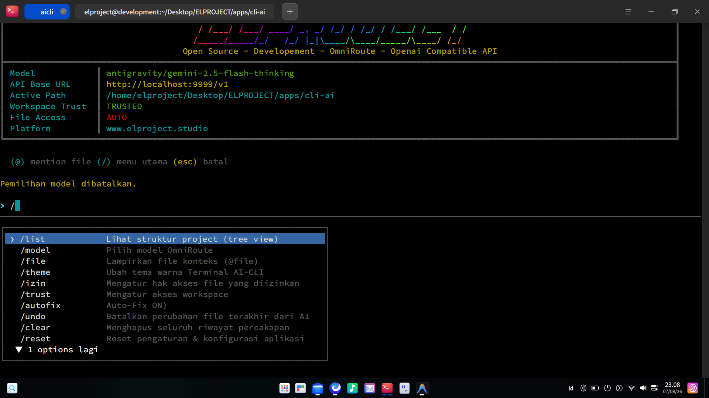
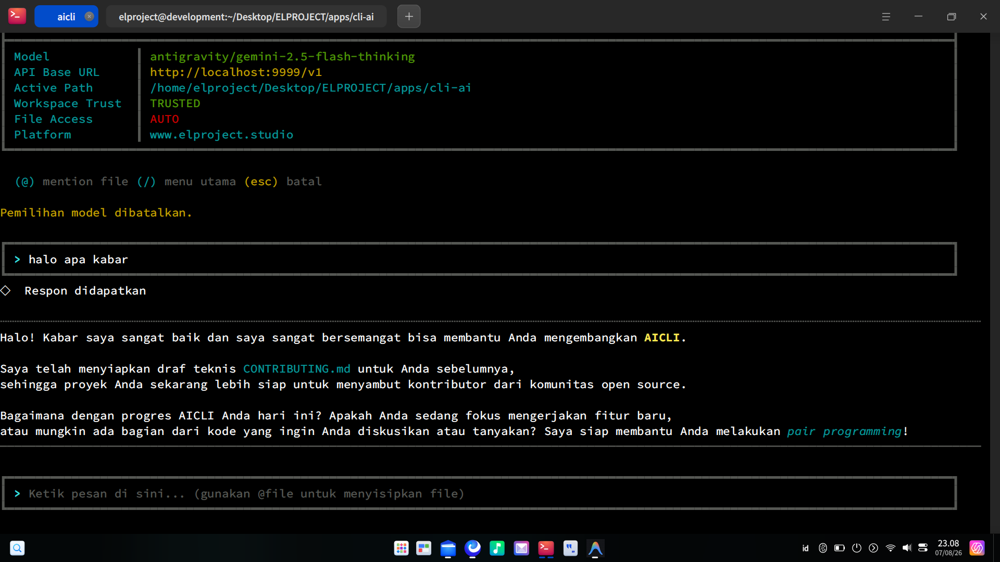

<div align="center">
  <h1>⚡ AICLI — AI Chat CLI & Code Agent</h1>
  <p><strong>A Next-Generation Interactive CLI Chat Agent for OmniRoute & OpenAI-Compatible APIs</strong></p>

  [](https://www.npmjs.com/package/aicli-omniroute)
  [](https://www.npmjs.com/package/aicli-omniroute)
  [](https://github.com/elproject-dev/Aicli_Omniroute_CodeCli/blob/main/LICENSE)
  [](https://www.typescriptlang.org/)
  [](https://nodejs.org/)
  [](#-contributing)
</div>

---

**AICLI** adalah *Command Line Interface* (CLI) chat agent yang interaktif dan modern, dibuat dengan **TypeScript**, **Node.js**, **Commander**, dan **@clack/prompts**. Alat ini tidak hanya sekadar antarmuka percakapan, tetapi juga dilengkapi dengan kemampuan **agentic** untuk membaca, menulis, mengedit, mencari, dan menjalankan perintah di dalam workspace Anda secara aman.

Kompatibel secara native dengan API bergaya OpenAI/OmniRoute (OpenAI, Ollama, LocalAI, vLLM, DeepSeek, dsb).

## 📸 Preview

<div align="center">
  
  <br>
  
  <br>
  
  <br>
  
  <br>
  
</div>

---

## Fitur Utama

- **Konsep Workspace Trust (Keamanan Tingkat Tinggi)** — Layaknya VS Code, AI hanya diizinkan mengeksekusi aksi file jika direktori saat ini telah disetujui (Trusted / Session / Restricted).
- **Agentic Code Agent** — Mendukung modifikasi dan analisis kode mandiri dengan built-in tools: `write_file`, `read_file`, `list_dir`, `grep_search`, `patch_file`, `run_command`, dan `activate_skill`.
- **Dukungan AI Skills Terintegrasi** — Otomatis mendeteksi dan menggunakan skill yang sudah terinstal (dari `~/.aicli/skills`, `~/.agents/skills`, `~/.gemini`, `~/.claude`, `~/.cursor`, paket `node_modules`, maupun folder `./skills` di workspace).
- **UI CLI yang Memukau** — Banner ASCII dinamis, dashboard sistem dengan indikator status, serta dukungan multitema (`default`, `magenta`, `emerald`, `sunset`, `ocean`, `monochrome`).
- **Input Box Modern & Interaktif** — Kursor berkedip, navigasi lengkap (Panah, Home/End, Ctrl+Kiri/Kanan), *inline autocomplete*, serta *bracketed paste* (paste multiline rapi).
- **Auto Context Injection (`@file`)** — Ketik `@` pada prompt untuk mencari dan menyisipkan file secara *real-time* ke konteks AI (dengan deteksi bahasa blok kode).
- **Izin Berbasis Skala Penuh** — Tiga mode perizinan: `ask` (wajib konfirmasi), `auto` (otomatis jalan), atau `off` (matikan akses file).
- **Streaming Real-time & Markdown Formatting** — Respon *reasoning* ditangani secara *seamless*, dukungan penuh terhadap sintaks markdown di dalam terminal, dan *syntax highlighting* blok kode.
- **Self-Healing Auto-Fix** — Secara otomatis mendeteksi error saat build/compile setelah file dimodifikasi, dan memberikan *feedback* kepada AI untuk perbaikan otomatis (maks. 3 percobaan).
- **Fitur Undo** — Batalkan aksi modifikasi AI terakhir secara instan lewat `/undo`.

---

## 🚀 Instalasi & Konfigurasi

Aplikasi ini telah dipublikasikan ke NPM, sehingga Anda dapat menjalankannya langsung atau menginstalnya secara global di sistem Anda.

### Prasyarat

- **Node.js** versi 18 atau lebih baru (direkomendasikan versi LTS).
- Koneksi ke server AI (OpenAI, OmniRoute Gateway, Ollama, LocalAI, dll).

### Opsi 1: Menjalankan Langsung Tanpa Install (Rekomendasi)
Anda dapat langsung menjalankan CLI ini menggunakan `npx`. Ini akan selalu menggunakan versi terbaru dari NPM.
```bash
npx aicli-omniroute
```

### Opsi 2: Install Global (Rekomendasi — Rapi & Tanpa Mengotori Direktori)
Jika Anda ingin perintah `aicli` atau `aicli-omniroute` terinstal permanen di sistem Anda tanpa membuat folder `node_modules` berserakan di Desktop atau folder kerja Anda:
```bash
npm install -g aicli-omniroute
```
Setelah terinstal, Anda dapat menjalankannya kapan saja dari direktori mana pun dengan mengetik:
```bash
aicli
# atau
aicli-omniroute
```

### Opsi 3: Install di Folder Khusus `ai-cli` (Terisolasi)
Jika Anda ingin menginstal secara lokal namun ingin semua file dan `node_modules` tetap rapi terisolasi di dalam satu folder khusus saja (`ai-cli`):

**Menggunakan Installer Otomatis:**
```bash
./install.sh
# atau tentukan nama folder khusus:
./install.sh ai-cli
```

**Atau Secara Manual:**
```bash
mkdir -p ai-cli && cd ai-cli
npm init -y
npm install aicli-omniroute
```

### Opsi 4: Inisialisasi Workspace via CLI (`init`)
Anda juga dapat membuat folder kerja terisolasi kapan saja menggunakan subperintah `init`:
```bash
aicli init ai-cli
cd ai-cli
aicli
```

### Opsi 5: Build dari Source Code (Untuk Developer)

1. **Clone repositori langsung ke folder `ai-cli`**:
   ```bash
   git clone https://github.com/elproject-dev/Aicli_Omniroute_CodeCli.git ai-cli
   cd ai-cli
   ```

2. **Install dependensi & Kompilasi**:
   ```bash
   npm install
   npm run build
   ```

3. **Link secara global (Opsional)**:
   ```bash
   npm link
   ```

---

## 🔧 Environment Variables

Aplikasi akan memandu Anda menyimpan URL dan API Key secara aman ke konfigurasi global (`~/.aicli/.env`) saat pertama kali dijalankan.
Namun, Anda juga dapat mendefinisikannya secara manual di file `.env` direktori proyek Anda untuk *override* per-proyek.

| Variabel              | Deskripsi                                                          | Default         |
| --------------------- | ------------------------------------------------------------------ | --------------- |
| `OPENAI_BASE_URL`     | URL base untuk API yang kompatibel dengan OpenAI / OmniRoute       | —               |
| `OPENAI_API_KEY`      | API Key untuk layanan AI Anda                                      | —               |
| `OPENAI_MODEL`        | Model default yang digunakan                                       | `gpt-3.5-turbo` |
| `FILE_PERMISSION_MODE`| Mode izin akses file: `ask`, `auto`, atau `off`                    | `ask`           |
| `CLI_THEME`           | Tema warna CLI (`default`, `magenta`, `ocean`, dll)               | `default`       |
| `ALLOWED_MODELS`      | (Opsional) Filter daftar model yang boleh digunakan (dipisah koma) | *Semua model*   |
| `AICLI_SKILLS_DIR`    | (Opsional) Direktori tambahan untuk memuat AI Skills kustom        | —               |

---

## 🛠️ Penggunaan

### Menjalankan CLI

Jika sudah diinstal atau di-link secara global:
```bash
aicli
# atau
aicli chat
```

Atau menggunakan npm dari dalam direktori source:
```bash
npm start
# Atau mode pengembangan
npm run dev
```

### Opsi Perintah Chat

```bash
aicli chat [options]

Options:
  -m, --model <model>        Model yang digunakan (default: dari env OPENAI_MODEL)
  -s, --system <prompt>      System prompt (default: "You are a helpful AI assistant.")
  -b, --base-url <url>       Base URL untuk OpenAI-compatible API
  -k, --api-key <key>        API Key untuk layanan
  -d, --skills-dir <dir>     Direktori kustom tambahan untuk memuat AI Skills
  -h, --help                 Tampilkan bantuan
```

### Manajemen AI Skills via CLI (`aicli skills`)

Anda dapat mengelola, melihat detail, membuat template, atau menginstal Skill AI langsung dari terminal:

```bash
# Menampilkan semua skill yang terdeteksi (Global, NPM, & Workspace)
aicli skills list

# Melihat detail & instruksi lengkap dari sebuah skill
aicli skills info <nama-skill>

# Menginstal skill dari repositori GitHub (owner/repo) atau path lokal
aicli skills install <owner/repo-atau-path>

# Membuat template skill baru (tambahkan -g untuk simpan di global ~/.aicli/skills)
aicli skills create <nama-skill> "Deskripsi singkat skill" -g
```

---

## 🕹️ Perintah Pintasan Interaktif

Selama berada di alur chat, ketik `/` untuk membuka panel aksi interaktif atau gunakan perintah langsung:

| Perintah    | Deskripsi                                                        |
| ----------- | ---------------------------------------------------------------- |
| `/`         | Membuka menu utama (dropdown interaktif).                        |
| `/skills`   | Mengelola, melihat, menginstal, atau mengaktifkan Skill AI.      |
| `/list`     | Menampilkan struktur pohon direktori proyek (tree view).         |
| `/model`    | Memilih model yang tersedia dari server secara dinamis.          |
| `/file`     | Melampirkan file konteks tambahan.                               |
| `/theme`    | Mengganti tema warna terminal.                                   |
| `/izin`     | Mengubah pengaturan izin tool file (`ask` / `auto` / `off`).     |
| `/trust`    | Mengelola status Workspace Trust.                                |
| `/autofix`  | Mengaktifkan/menonaktifkan Auto-Fix Build Errors.                |
| `/undo`     | Membatalkan modifikasi file terakhir.                            |
| `/clear`    | Membersihkan riwayat percakapan.                                 |
| `/reset`    | Menghapus konfigurasi awal & setup ulang dari nol.               |
| `/exit`     | Keluar dari program (dapat juga menggunakan `exit` atau `quit`). |

---

## 🤝 Contributing

Kami sangat menyambut kontribusi dari komunitas! Baik itu pelaporan bug, usulan fitur baru, hingga pull request.

Harap baca [CONTRIBUTING.md](https://github.com/elproject-dev/Aicli_Omniroute_CodeCli/blob/main/CONTRIBUTING.md) untuk panduan lengkap tentang bagaimana Anda dapat mulai berkontribusi pada AICLI. 

Mari bangun *CLI Agent* terbaik bersama-sama! 🚀

---

## ❓ Troubleshooting

- **Tidak ada respons dari AI?** Pastikan `OPENAI_BASE_URL` dan `OPENAI_API_KEY` terkonfigurasi dengan benar (tersimpan otomatis di `~/.aicli/.env`).
- **File `@file` tidak ditemukan?** Sistem keamanan hanya mengizinkan injeksi file *di dalam workspace aktif* tempat perintah dijalankan (dengan batas maksimal 500 KB).
- **Efek Bintang / Markdown tidak rapi?** Kami telah memperbaikinya sehingga kode markdown akan di-render menggunakan style terminal native alih-alih raw teks. Pastikan versi terbaru telah ter-build!

---

## 📄 Lisensi

Project ini dilisensikan di bawah lisensi **ISC**.

---

<div align="center">
  <i>Powered by <b>ELPROJECT</b> & <b>Ai kesayangan</b></i>
</div>
